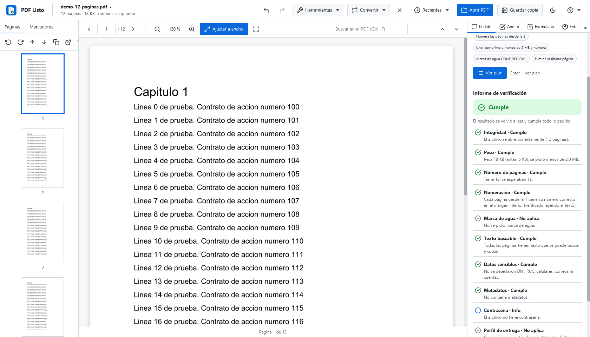

# PDF Listo

Editor de PDF de escritorio para Windows que **funciona sin internet**. Se maneja con frases
(«une, comprime a menos de 2 MB y numera»), muestra un **plan** antes de actuar, trabaja siempre sobre una **copia**
y **verifica** al final, releyendo el archivo, que el resultado cumple lo pedido.



## Qué hace

- **Páginas:** rotar, reordenar (arrastrando), duplicar, eliminar, unir, dividir, extraer.
- **Pedidos con palabras:** plan visible, preguntas si falta un dato, verificación e informe en PDF, historial con «Repetir».
- **Herramientas:** comprimir («a menos de X MB»), numerar, marca de agua, encabezado y pie, tamaño A4/Carta.
- **Privacidad:** detecta DNI, RUC, celulares, correos, cuentas, CCI y direcciones; **tachado real** verificado;
  metadatos; contraseña y permisos.
- **Anotar y firmar:** resaltados, notas, formas, dibujo, texto, imágenes, firma visual y sellos. **Formularios:** llenar y aplanar.
- **OCR** (Tesseract) para PDF escaneados, con mejora de escaneos.
- **Entrega:** perfiles (tesis, trámite, licitación) que validan y corrigen; recetas y aprendizaje de recetas.
- **Facturas electrónicas con QR (SUNAT):** validación de IGV, RUC y duplicados, exportación a Excel.
- **Convertir:** imágenes ↔ PDF, texto ↔ PDF, extraer imágenes, Word → PDF (con LibreOffice).
- Deshacer/rehacer ilimitado, recuperación tras un cierre inesperado, modo claro/oscuro.

## Instalar

Descarga y ejecuta `PDFListo-1.0.1.exe`, o descomprime `PDFListo-1.0.1-portable.zip` y abre `PDF Listo.exe`.
Trae su propio Java y las librerías del OCR: no hay que instalar nada más.

## Desarrollo

```powershell
.\mvnw.cmd javafx:run        # abrir la app
.\mvnw.cmd test              # pruebas automáticas (107)
powershell -ExecutionPolicy Bypass -File packaging\construir-instalador.ps1   # instalador en dist\
```

Requiere JDK 17 o superior. Tecnologías: Java, JavaFX 21 + AtlantaFX, Spring Boot 3.3, SQLite, Apache PDFBox 3,
Tesseract 5 (Tess4J), ZXing, OpenPDF y Apache POI.

## Documentación

| Documento | Para quién |
|---|---|
| [Manual de usuario](docs/manual/manual-usuario.html) (también en la app: Ayuda → Manual) | Quien usa la app |
| [Manual técnico](docs/manual-tecnico.md) | Quien la compila, empaqueta o extiende |
| [Decisiones técnicas](docs/decisiones-tecnicas.md) | Por qué está hecha así |
| [Diagrama de arquitectura](docs/diagramas/arquitectura.svg) · [casos de uso](docs/diagramas/casos-de-uso.svg) | Visión general (también en Mermaid, `.mmd`) |
| [Guion de demostración (10 min)](docs/guion-demostracion.md) | Presentación con los PDF de `ejemplos/` |

## Privacidad

Ningún archivo sale del equipo. Los datos de la app (historial, recetas, firmas, configuración y registro) están en
`%APPDATA%\PDFListo`. Las bibliotecas usadas y sus licencias están en Ayuda → Acerca de
(`src/main/resources/licencias/TERCEROS.txt`).
