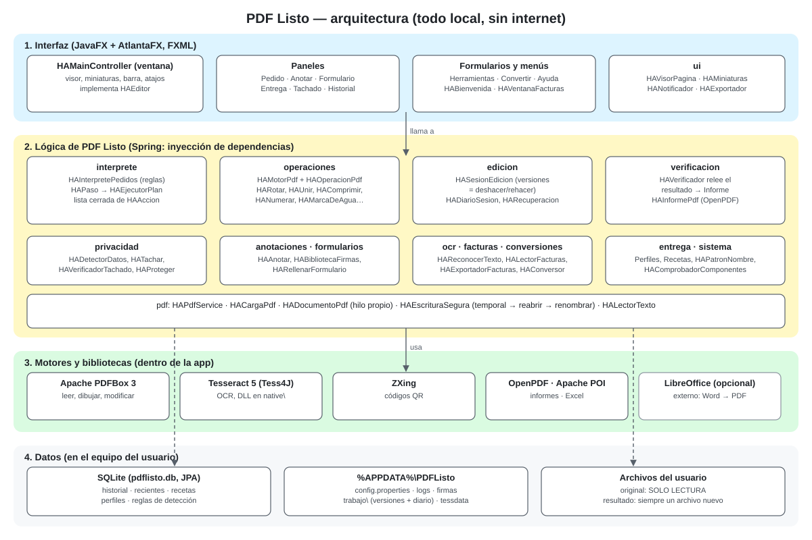

# PDF Listo — Manual técnico

Versión 1.0.1 · Java 17+ · Windows 10/11 (64 bits)

Este documento explica cómo está construida la aplicación, cómo compilarla, probarla y empaquetarla, y cómo
extenderla. Las razones de cada elección están en [decisiones-tecnicas.md](decisiones-tecnicas.md).

## 1. Arquitectura



Cuatro capas (versión editable en Mermaid: [diagramas/arquitectura.mmd](diagramas/arquitectura.mmd)):

1. **Interfaz** (JavaFX + AtlantaFX): `MainController` (ventana, implementa la interfaz `Editor`), paneles de la
   derecha, formularios del panel deslizante, menús.
2. **Lógica** (servicios de Spring): intérprete, operaciones, versiones, verificación, privacidad, anotaciones,
   formularios, OCR, facturas, conversiones, entrega y sistema.
3. **Motores**: PDFBox, Tesseract (Tess4J), ZXing, OpenPDF, Apache POI y, opcionalmente, LibreOffice.
4. **Datos**: SQLite (`pdflisto.db`), carpeta `%APPDATA%\PDFListo` y los archivos del usuario (solo lectura).

Casos de uso: [diagramas/casos-de-uso.svg](diagramas/casos-de-uso.svg).

### Paquetes (`src/main/java/pe/pdflisto/`)

| Paquete | Responsabilidad |
|---|---|
| raíz | `Launcher` (entrada; `--comprobar archivo.txt` hace la comprobación sin ventana), `JavaFxApplication` (arranque, ícono, red de seguridad de errores), `PdfListoApplication` |
| `config` | `CarpetaDatos` (`%APPDATA%\PDFListo` o la propiedad `app.datos`), `Configuracion` (`config.properties`) |
| `pdf` | `PdfService`, `CargaPdf`, `DocumentoPdf` (dibujo en hilo propio), `EscrituraSegura`, `BuscadorTexto`, `LectorTexto`, `DiagnosticoPdf` |
| `operaciones` | Contrato `OperacionPdf` + `MotorPdf` + `Control` (progreso/cancelar) y todas las operaciones |
| `edicion` | `SesionEdicion` (versiones), `DiarioSesion`, `Recuperacion`, `CarpetaTrabajo` |
| `interprete` | `InterpretePedidos`, `Accion`, `Paso`, `Pregunta`, `EjecutorPlan`, `SerializadorPasos` |
| `verificacion` | `Verificador` (planes), `VerificadorOperacion` + `Esperado` (cada operación del menú), `TextoEnMargen`, `Requisitos`, `InformeVerificacion`, `InformePdf` |
| `privacidad` | `DetectorDatos`, `ValidadorRuc`, `Tachar`, `VerificadorTachado`, `LimpiarMetadatos`, `Proteger`, `QuitarContrasena` |
| `anotaciones`, `formularios` | Anotaciones, firmas (`BibliotecaFirmas`), llenado y aplanado de formularios |
| `ocr` | `ReconocerTexto`, `MejoraEscaneo`, `DatosOcr` |
| `facturas` | `LectorFacturas`, `ParserQrSunat`, `ValidadorComprobantes`, `ExportadorFacturas` |
| `conversiones` | `Conversor`, `ConversorWord` (LibreOffice) |
| `entrega` | Perfiles, recetas (y aprendizaje), `PatronNombre` |
| `sistema` | `ComprobadorComponentes`, `EstadoComponente`, `InfoApp` (versión, licencias), `ManualUsuario` |
| `model`, `repository`, `service` | Entidades JPA y servicios de base de datos |
| `controller` | `MainController`, paneles (`PanelPedido`, `PanelAnotar`, `PanelFormulario`, `PanelEntrega`, `PanelTachado`, `PanelHistorial`), `Formularios*`, `MenuAyuda`, `Bienvenida`, `VentanaFacturas` |
| `ui` | `VisorPagina`, `Miniaturas`, `CeldaMiniatura`, `Notificador`, `Exportador` |

Recursos: `view/main-view.fxml`, `css/app.css`, `icono/`, `licencias/TERCEROS.txt`, `tessdata/` (spa, eng) y el manual
de usuario (`docs/manual` se copia como `/manual` al compilar; ver `pom.xml`).

## 2. Flujos principales

### Pedido escrito → plan → ejecución → verificación

1. `PanelPedido` envía la frase a `InterpretePedidos.interpretar(frase, contexto)`.
2. El intérprete devuelve `Paso`s (cada uno con una `Accion` de la lista cerrada) y `Pregunta`s si falta algo. Los pasos
   se ordenan según el orden del enum `Accion` (unir primero, comprimir al final).
3. El usuario aprueba. `EjecutorPlan` convierte cada paso en una `OperacionPdf` y la ejecuta con `MotorPdf` sobre la
   versión actual: resultado en un archivo nuevo, intermedios borrados.
4. `EjecutorPlan.requisitos(...)` describe lo esperado; `Verificador.verificar(...)` relee el archivo final y produce un
   `InformeVerificacion` («Cumple» / «Revisar» por comprobación).
5. La versión se agrega a la `SesionEdicion` (deshacer = volver a la anterior) y se anota en el historial (SQLite).

### Verificación de cada operación del menú

Cada `OperacionPdf` declara `esperado()` (lista de `Esperado`: giro, orden, numeración, texto, tamaño, peso,
metadatos, contraseña, anotaciones, formulario…). `MotorPdf` la adjunta al `Resultado`; `MainController.aplicar`
llama a `VerificadorOperacion.verificar(antes, después, esperado)` en segundo plano, que abre las dos versiones y las
compara. La tarjeta antes/después muestra «Verificado: cumple» o «Revisar» con el detalle. Los planes no traen
`esperado` (usan el `Verificador` completo).

### Verificación de lo que se crea aparte

Dividir, extraer páginas y las conversiones llaman a `Editor.exportar(descripción, trabajo, esperado)` con un
`EsperadoArchivos` (partes, imágenes→PDF, texto→PDF, Word→PDF, PDF→imágenes, PDF→texto, extraer imágenes).
`MainController.exportar` llama a `VerificadorArchivos`, que relee los archivos creados (y los compara con el PDF de
origen) y muestra «Listo» o «Revisar el resultado» con una tarjeta de detalle.

El Excel de facturas usa `Exportador.guardarVerificado`: tras generarlo, `VerificadorExcelFacturas` lo reabre con
Apache POI, compara cada fila con los comprobantes, calcula todas las fórmulas y compara totales y resumen con lo que
calcula la app. El resultado aparece en la ventana de facturas.

### Escritura segura

`MotorPdf` → `EscrituraSegura`: guardar en `*.tmp` → volver a abrir con PDFBox → si abre bien, renombrar al destino.
Si cualquier paso falla, el destino no se toca y se informa el error.

### Tachado

`DetectorDatos` encuentra los datos con su posición (`LectorTexto` da la caja de cada letra) → el usuario confirma →
`Tachar` dibuja cada página afectada como imagen con los recuadros y le agrega texto invisible con lo no tachado →
`VerificadorTachado` busca los datos tachados en el resultado; si aparece alguno, el resultado **no** se declara seguro.

### Recuperación tras un cierre inesperado

Mientras hay cambios sin guardar, la app escribe un diario (`sesion.properties`) junto a las versiones en `trabajo\` y
mantiene un bloqueo (`sesion.lock`). Al iniciar,
`Recuperacion.buscar()` encuentra sesiones sin cerrar y la ventana ofrece recuperarlas. Las contraseñas nunca se
escriben en disco.

## 3. Compilar, probar y ejecutar

Requisitos de desarrollo: JDK 17 o superior (se usa JDK 21, IBM Semeru) y el wrapper de Maven incluido.

```powershell
cd D:\proyectopdf\editorpdf
.\mvnw.cmd javafx:run          # abrir la app
.\mvnw.cmd test                # 130 pruebas automáticas
.\mvnw.cmd -o ...              # sin internet (dependencias ya descargadas en ~/.m2)
```

Abrir con un PDF o con otra carpeta de datos (útil para probar sin tocar los datos reales):

```powershell
.\mvnw.cmd -o dependency:build-classpath -Dmdep.outputFile=target/cp.txt
java -Dapp.datos=C:\temp\datos-prueba -cp "target/classes;$(Get-Content target/cp.txt)" pe.pdflisto.HALauncher archivo.pdf
```

### Pruebas

`src/test/java/pe/pdflisto/**` (JUnit 5). Cubren operaciones, rangos de páginas, cancelación, intérprete, plan y
verificación, detector de datos, tachado y su verificación, recuperación, anotaciones, formularios, OCR, facturas,
conversiones, configuración y comprobación de componentes. Los PDF de prueba se generan en carpetas temporales;
algunas pruebas usan `ejemplos/`.

### Capturas del manual de usuario

```powershell
.\mvnw.cmd -o test-compile
java -cp "target/classes;target/test-classes;$(Get-Content target/cp.txt)" pe.pdflisto.herramientas.HAGenerarCapturas `
     docs/manual/capturas target/datos-manual ejemplos
```

Arma la ventana real **sin mostrarla**, la maneja por código (sin ratón ni teclado) y guarda 13 capturas PNG.

### Diagramas

`python docs/diagramas/generar-diagramas.py` regenera los SVG; las versiones Mermaid (`.mmd`) se editan a mano.

## 4. Empaquetar (instalador de Windows)

```powershell
powershell -ExecutionPolicy Bypass -File packaging\construir-instalador.ps1              # portable + .exe
powershell -ExecutionPolicy Bypass -File packaging\construir-instalador.ps1 -SinInstalador # solo portable
```

Resultado en `dist\`:

| Archivo | Qué es |
|---|---|
| `PDF Listo\` | Aplicación con Java incluido (jlink: `java.se`, `jdk.unsupported`, `jdk.localedata`… solo locales es/en) |
| `PDFListo-1.0.1-portable.zip` | La misma carpeta comprimida (~130 MB) |
| `PDFListo-1.0.1.exe` | Instalador por usuario (menú Inicio, acceso directo opcional, «Abrir con» para .pdf) |

Pasos del script: compila (`-Dspring-boot.repackage.skip=true`, jar normal) → copia las bibliotecas de ejecución a
`target\instalador\entrada` → crea `entrada\native` con `libtesseract541.dll`, `libleptonica1841.dll` (sacadas de los jar
de Tess4J/Lept4J) y `msvcp140.dll`, `vcruntime140.dll`, `vcruntime140_1.dll` (del JDK o de System32) → `jpackage --type
app-image` con `-XX:MaxRAMPercentage=60`, `-Djna.library.path=$APPDIR\native`, `-Dfile.encoding=UTF-8` → ejecuta
`PDF Listo.exe --comprobar` para verificar que el resultado arranca y que el OCR funciona → zip → si hay WiX 3.x
(en `tools\wix` o en el PATH; si falta lo descarga una vez desde GitHub) crea el `.exe`.

El instalador usa un `--win-upgrade-uuid` fijo: una versión nueva reemplaza a la anterior. Para publicar una versión
nueva basta con cambiar `<version>` en `pom.xml` (también se muestra en Ayuda → Acerca de).

## 5. Datos y configuración en tiempo de ejecución

| Ubicación | Contenido |
|---|---|
| `%APPDATA%\PDFListo\pdflisto.db` | SQLite: recientes, historial (con `combinacion` para aprender recetas), reglas de detección, perfiles, recetas |
| `config.properties` | Tema, última carpeta, patrón de nombre, bienvenida, recetas rechazadas |
| `logs\pdflisto.log` | Registro (5 MB × 5 archivos). Nivel INFO para `pe.pdflisto`, ERROR para PDFBox |
| `trabajo\` | Versiones temporales, diario y bloqueo; se borran al cerrar |
| `firmas\` | Biblioteca de firmas y su posición guardada |
| `tessdata\`, `manual\` | Copiados desde dentro de la app la primera vez que se usan |

La propiedad de sistema `app.datos` cambia la carpeta de datos (pruebas, capturas).

## 6. Cómo extender

### Agregar una operación nueva

1. Crear una clase en `operaciones` que implemente `OperacionPdf` (`descripcion()` y `aplicar(doc, recursos)`). No abre ni
   guarda archivos: eso lo hace `MotorPdf`. Sobrescribir `esperado()` con lo que promete (si hace falta, un tipo nuevo
   en `Esperado` y su comprobación en `VerificadorOperacion`); por defecto solo se comprueba que no cambien las páginas.
2. Agregar su formulario en `FormulariosHerramientas` y un ítem en el menú Herramientas (`main-view.fxml` + `MainController`),
   ejecutándola con `editor.aplicar(...)` para que cree una versión y quede en el historial.
3. Agregar pruebas en `src/test/java/pe/pdflisto/operaciones`.

### Hacer que el intérprete la entienda

1. Agregar el valor al enum `Accion` **en la posición que corresponda al orden de ejecución**.
2. Agregar la regla en `InterpretePedidos` (`clave(regex, Accion.X)`) y la extracción de sus datos.
3. Convertir el paso en operación en `EjecutorPlan`, describir lo esperado en `requisitos(...)` y, si hace falta, una
   comprobación nueva en `Verificador`.
4. Soportarlo en `SerializadorPasos` (recetas) y agregar pruebas en `InterpretePedidosTest` y `PlanYVerificacionTest`.

### Agregar un idioma al OCR

Poner su `.traineddata` (de `tessdata_fast`) en `src/main/resources/tessdata`, agregarlo a `DatosOcr.ARCHIVOS` y al enum
`DatosOcr.Idioma`.

## 7. Diagnóstico de problemas

- **Ayuda → Comprobar componentes** (o `"PDF Listo.exe" --comprobar salida.txt`): Java y memoria, carpeta de datos,
  Visual C++, OCR (carga real de Tesseract) y LibreOffice.
- **Errores no previstos:** la «red de seguridad» de `JavaFxApplication` los registra en el log y muestra un aviso sin
  cerrar la app.
- **La app no inicia:** suele ser otra instancia abierta (la base SQLite está en uso); el mensaje lo indica.

## 8. Limitaciones conocidas

Están resumidas en el manual de usuario. Las más
importantes: no se edita el texto original de un PDF; las páginas tachadas pasan a imagen; las facturas deben tener QR; Word a PDF requiere LibreOffice (conversión real no probada en el equipo de
desarrollo); la firma es visual, no digital con certificado.
